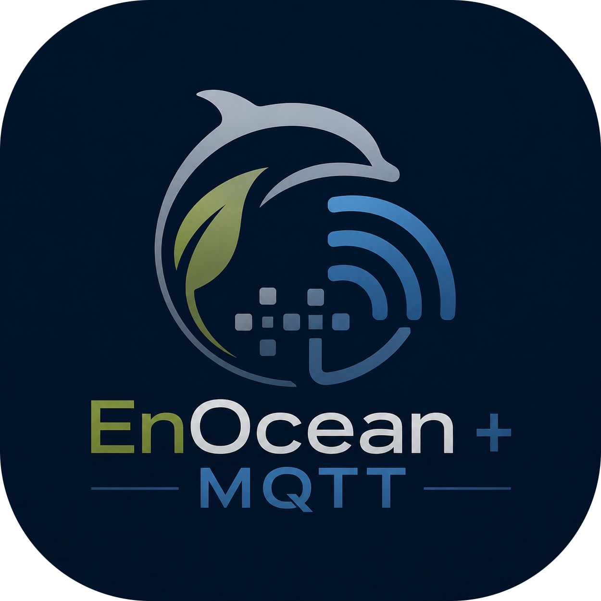

<p align="center">
  
</p>

<h1 align="center">enocean-mqtt</h1>

<p align="center">
Modular EnOcean ESP3 bus monitor and MQTT gateway for Linux and Raspberry Pi.
</p>

<p align="center">
Raw telegram monitoring · EEP decoding · MQTT integration · REST API · Web UI · SQLite telegram storage
</p>

Copyright © 2026 Falk G. Schulte (fgs-IT | smart.home.singapore)

---

> [!NOTE]
> `enocean-mqtt` is under active development. Core functions are considered stable, but may still change before version 1.0.0.

## Overview

`enocean-mqtt` is an open, modular and manufacturer-independent middleware for EnOcean networks.

It combines a passive EnOcean bus monitor with an MQTT gateway and provides a common runtime pipeline for live ESP3 traffic, replay data and injected test telegrams.

The project is designed for home automation, diagnostics, integration testing and connection to external automation platforms without depending on a specific vendor ecosystem.

## Key Features

- live EnOcean RX/TX through ESP3-compatible transceivers
- USB300/TCM310-class serial interface support
- multiple named EnOcean interfaces with selectable TX interface
- raw and decoded telegram publishing via MQTT
- EEP-based runtime decoding
- physical and virtual device model
- bidirectional telegram generation for supported profiles
- Teach-In detection and TX Teach-In generation
- RSSI and repeater information
- unknown-device discovery
- replay of DolphinView and Weinzierl captures
- MQTT-based runtime commands
- authenticated REST API with OpenAPI/Swagger interface
- integrated Web UI for dashboard, bus monitoring, metrics, device management and configuration
- SQLite telegram archive with bounded retention
- CSV device import and export
- CSV bus monitor export
- health, status and runtime metrics via MQTT and API

Support of devices depends on the individual EEP or manufacturer-specific profile. Dedicated compatibility lists document which definitions are implemented and which have been validated with real hardware.

## Architecture

MQTT is the primary integration and transport interface. Raw telegram data remains available independent of semantic decoding so that unsupported or unknown telegrams are not lost.

```text
                    +-----------------------+
                    |  EnOcean transceiver  |
                    |      ESP3 / UART      |
                    +-----------+-----------+
                                |
                                v
+------------------------------------------------------------------+
|                         enocean-mqtt                             |
|                                                                  |
|  ESP3 transport -> telegram pipeline -> EEP / device processing  |
|                         |                    |                   |
|                         |                    +--> TX / Teach-In  |
|                         |                                        |
|              +----------+-----------+                            |
|              |          |           |                            |
|              v          v           v                            |
|            MQTT       SQLite    REST API / Web UI                |
+------------------------------------------------------------------+
               |
               v
     automation and integration systems
```

Live traffic, replay data and injected telegrams use the same processing architecture to support reproducible testing and diagnostics.

## MQTT-First Design

The MQTT model separates telegram-oriented bus monitor traffic, device-oriented automation data and gateway runtime information.

The main topic branches are:

```text
<base_topic>/
├── busmonitor/
├── device/
├── alias/
├── virtual/
└── gateway/
```

MQTT is used for:

- raw and decoded telegrams
- device states and metrics
- device and virtual-device commands
- gateway status and health information
- runtime commands
- replay and diagnostic workflows

The REST API and the Web UI expose the same runtime data and operations where applicable.

## Bus Monitor

The integrated bus monitor is intended as an engineering and diagnostic tool for EnOcean installations. It provides live and historical RX/TX inspection, raw telegram data, decoded information, RSSI and repeater data, filtering, Teach-In indication and SQLite-backed history.

Replay support allows captured EnOcean traffic to be processed through the same runtime pipeline without requiring live radio hardware.

## Devices and EEPs

`enocean-mqtt` uses a registry-based EEP and device model. It supports official EnOcean Equipment Profiles as well as manufacturer-specific profile definitions where required.

The public repository contains compatibility lists for:

- implemented and tested EEPs
- implemented and tested manufacturer-specific profiles
- tested devices

A profile being implemented does not automatically mean that every compatible physical device has been hardware-tested. The compatibility lists distinguish implementation status from runtime validation.

## REST API and Web UI

The integrated FastAPI service provides an authenticated REST API and browser-based Web UI.

The Web UI currently includes operational views for:

- gateway dashboard and health
- live and historical bus monitoring
- EnOcean metrics
- physical and virtual devices
- configuration and interface management
- API-token management

Interactive REST API documentation is provided through the OpenAPI/Swagger interface generated by FastAPI.

## Installation

`enocean-mqtt` requires Python 3.11 or newer and is intended primarily for Linux and Raspberry Pi systems.

Detailed installation, configuration and operating instructions are maintained separately in the **User Guide**. The guide also covers service installation, initial API authentication and a post-installation smoke test.

Container deployment (Docker) is planned but is not yet part of the validated runtime environment.

## Current Status

The core runtime is operational and has been validated with live EnOcean hardware as well as replay-based test workflows. Major implemented subsystems include:

- MQTT gateway runtime
- ESP3 live RX/TX
- telegram decoding and generation
- replay and injection pipeline
- SQLite persistence
- REST API
- Web UI
- physical and virtual device handling
- runtime commands and diagnostics

Under development:

- bidirectional 4BS teach-in
- VLD (D2) teach-in

Planned:

- EnOcean secure
- remote management & commissioning
- Docker deployment
- TLS-capable MQTT support

EEP and device coverage is being expanded continuously.

## Development

Contributions are welcome. Contributor and AI-agent guidance will be provided in `CONTRIBUTING.md` and `AGENTS.md`.

## open bridge server Integration

`enocean-mqtt` is designed as a standalone EnOcean/MQTT middleware, but integration with **open bridge server (OBS)** is a primary external integration target.

OBS is an open-source multiprotocol server for building automation. `enocean-mqtt` can already be integrated through MQTT using the existing OBS MQTT adapter:

```text
EnOcean
→ enocean-mqtt
→ MQTT
→ OBS MQTT Adapter
→ open bridge server
```

In parallel, a dedicated OBS EnOcean adapter has been developed and is being tested. This allows OBS to discover gateway status, devices and datapoints directly from `enocean-mqtt` and map them to native OBS data points:

```text
EnOcean
→ enocean-mqtt
→ REST API v1
→ OBS Adapter
→ open bridge server
```

- **open bridge server website:** https://open-bridge.io
- **open bridge server project:** https://github.com/abeggled/openbridgeserver

## License

`enocean-mqtt` is released under the MIT License. See `LICENSE` for details.
